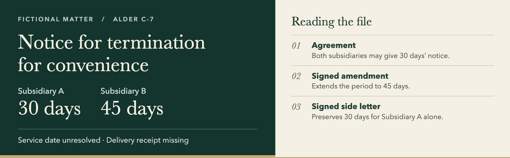
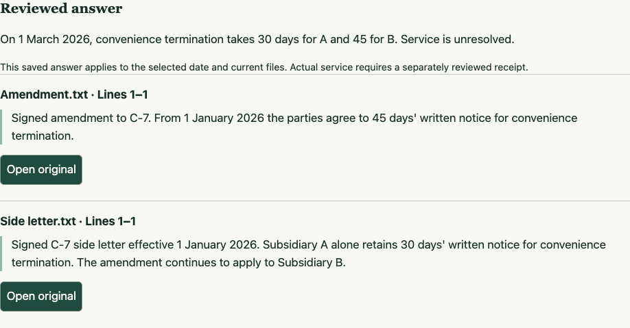

# Evidence OS

A contract review workspace for commercial lawyers. Find the term that applies to a particular party, open the exact wording, and send a cited answer to a colleague for review.

**[Download the Quickstart ZIP](https://github.com/raghavbadhwar/evidence-os/releases/download/v0.1.0-pilot.1/Evidence-OS-Quickstart.zip)** · [Setup guide](docs/practice-setup.md) · [Firm IT guide](docs/matter-desk.md#for-an-administrator) · [Release notes](https://github.com/raghavbadhwar/evidence-os/releases/tag/v0.1.0-pilot.1)

## Try your first matter

1. **Extract the Quickstart ZIP.** Open **Start Evidence OS.command** on Mac or **Start Evidence OS.cmd** on Windows. On Linux, run `sh "Start Evidence OS.command"` in the extracted folder.
2. **Open the desk.** The launcher prepares Python and the required packages. It opens your browser and prints two practice access codes. Sign in with the **Researcher code**.
3. **Follow the file to an answer.** Under **Your first matter**, fetch the signed side letter, open the original clauses, and submit your reading. Switch to the **Reviewer code** to check the citations and approve. Search again to see the approved answer.

Allow internet access for the first setup. The exercise uses fictional files, runs locally, and needs no model account. If setup stops, open **Doctor Evidence OS** for your operating system. [Setup and repair instructions](docs/practice-setup.md#check-or-repair-the-installation)

<strong>See the reviewed answer in the browser</strong>

This is the end of the practice exercise. Each source opens the file behind the cited lines.

## What the workspace supports

| Task | What the lawyer or agent can do |
| --- | --- |
| Find evidence | Search a permitted matter by question, exact filename or reference. Fetch approved files and open the original behind a passage. |
| Review and remember | Save an open question or propose a sourced answer. A second reviewer can approve, decline or withdraw it. Changed files trigger fresh review. |
| Test a follow-up | Apply an approved calendar-day rule to a proposed notice period. The system checks party, date, route, conditions and source versions. Establishing a service date requires separately reviewed evidence. |
| Work with an agent | Codex and Claude Code can query the same workspace through the CLI. On a firm-approved deployment, hosted Codex Sol can propose and check a first reading. |

## Using Evidence OS at a firm

| Reader | Start here |
| --- | --- |
| Lawyer or supervising partner | [Matter desk, citations and reviewer decisions](docs/matter-desk.md) |
| IT or agent administrator | [Workspace architecture](docs/evidence-workspace.md) · [Connect Codex or Claude Code](docs/matter-desk.md#use-evidence-os-inside-codex-or-claude-code) |
| Pilot lead | [Firm acceptance checks](docs/real-file-study/firm-handoff.md#firm-acceptance) · [Real-file study protocol](docs/real-file-study/protocol.md) |
| Developer | [Install from source, run checks and build the ZIP](docs/development.md) |

**Pilot status.** The practice review has been exercised end to end in Chrome on macOS. Native Windows setup and installation on the firm’s server await verification. Legal accuracy and lawyer time savings on unfamiliar client files remain unmeasured. Automated renewal-window and business-day deadline calculations are outside the current workflow. [Audit and evaluation scope](docs/real-file-study/audit.md)
