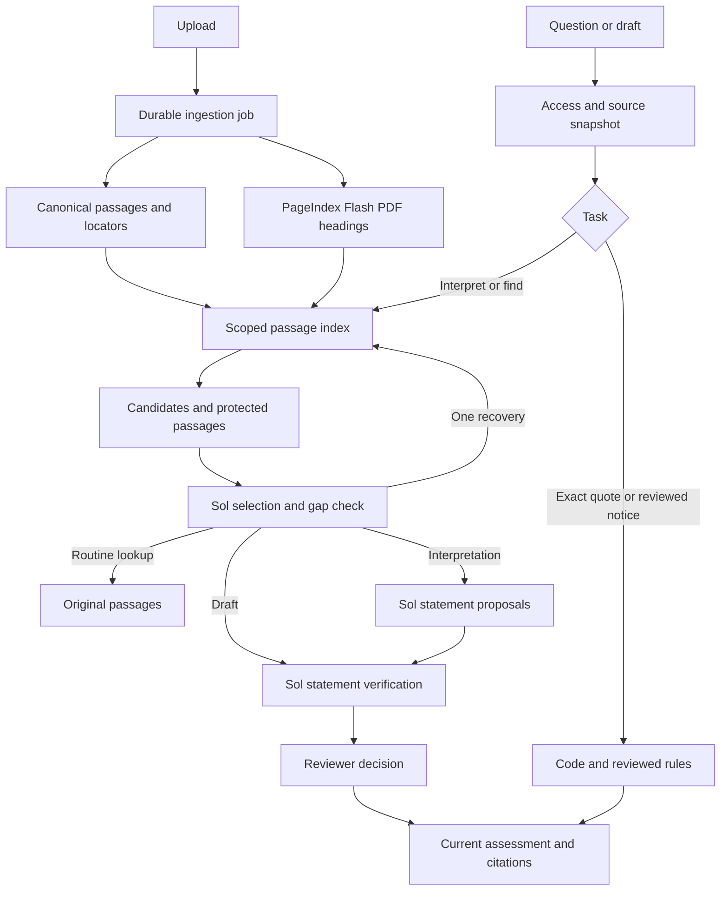

# Evidence OS workspace

The [matter desk and CLI guide](matter-desk.md) covers local source fetch, exact references, research notes, independent approval and changed-file handling.

## Execution



**Core routes.** `find` searches indexed terms and PDF section headings. `quote` resolves a supplied passage ID and returns its entire original text. `locate` uses Codex Sol to select passages. `interpret` lets Sol propose statements and checks them in a separate Sol invocation. `draft-checks` accepts separate complete statements and skips the proposal pass. Selection and support checks are distinct. A reviewer must approve supported interpretations before publication. Unresolved premises and contradictory drafts remain visible.

**Independent evidence.** The coordinator retains registered amendments, schedules, definitions, receipts, explicit dependencies, nearby passages, marked table cells and passages with qualification language. It rechecks the current scope before model dispatch and publication. Protection is conservative. Implicit cross-references or unregistered external authorities can still be missed. A ready snapshot means its registered sources ingested successfully. It makes no claim about undiscovered documents.

**Reviewed notice rules.** Use the source-set detail endpoint to obtain the snapshot and the document passage endpoint to inspect complete sources. A reviewer submits party, termination route, calendar days, inclusive effective start, exclusive effective end, conditions, cited IDs and a review note. The reviewer owns the interpretation. An answer requires exactly one applicable rule and all its conditions. For a hypothetical, supply assumptions and proposed days. For an actual service event, a reviewer first registers a dated receipt with original evidence. The system computes the date difference and determines only whether the reviewed period is met. The reviewer can record or withdraw delivery evidence in the browser. A withdrawal preserves the original and reason, invalidates prior supported calculations that used that receipt and prevents their reuse for draft proposals. A different current receipt can still support a calculation for the same rule. Rules can be listed and revoked. New versions and scope changes require fresh review. Other legal counting conventions require their own reviewed operations.

**First-time notice review.** In the workspace, select **Review contractual notice** and enter the party, route and as-of date. The equivalent API request is `POST /v1/source-sets/{id}/answers` with `mode: "interpret"`, a `question`, `as_of` and `notice_review: {"party": "...", "route": "..."}`. For an opted-in matter with a ready packet of at most 64 passages and 32,000 serialized bytes of original text and IDs, Sol considers the entire packet, including unlinked documents. Both providers receive original passages without filenames or user-assigned roles. Sol checks the proposed period and relationships against the packet. The response links the changing and affected passages, their proposed scope and dates, and the evidence for execution. An oversized packet returns an unresolved result and lexical matches for manual inspection.

Only an authorized reviewer can release a supported contractual period. Reviewers can reject a proposal, rerun with corrected scope, and bind their own interpretation to the current source IDs using the existing notice-rules endpoint. Source, access and reviewed-rule changes invalidate prior first-time findings. Actual service still requires the separate reviewed receipt operation.

## Configuration

| Setting | Effect |
|---|---|
| `EVIDENCE_ROOT` | Local source blobs, canonical artifacts and development SQLite catalogue. Defaults to `.evidence`. |
| `EVIDENCE_DATABASE_URL` | PostgreSQL DSN for the shared matter catalogue, jobs, evidence and reviews. Install the existing `postgres` dependency group. Share the same protected source filesystem across worker and API. Canonical parser artifacts use their own local index. |
| `EVIDENCE_AUTH_FILE` | Operator-owned JSON mapping random bearer tokens to tenant UUID, actor UUID and reviewer boolean. The initializer creates a local reviewer with file mode 0600. Reload processes after credential rotation. Matter owners grant reader/editor membership to trusted principal IDs. |
| Codex CLI login | The Evidence OS service uses `gpt-6.2-sol` through its signed-in Codex account. See [setup and hosted consent](matter-desk.md#hosted-codex-sol). |
| `PROOFCOUNSEL_OCR_ENABLED` | Enables the existing OCR route when the necessary parser binaries are available. For PDF extraction install Poppler. For OCR install Tesseract and the parser's OCR dependencies. |

Hosted calls require explicit opt-in when creating the matter. Matching a reviewed rule, open-source Flash in raw mode, exact quotations and lexical search run locally. If Flash cannot identify a hierarchy, ingestion records the canonical fallback. Failed or partial ingests block substantive assessments. The UI runs without external scripts or fonts.

For a separate worker, use `serve --external-worker` and run `python -m proofcounsel_ingest.evidence worker` with identical configuration. A crashed worker's lease becomes claimable after five minutes. A replaced document or superseded lease cannot publish. An identical active upload is idempotent. Uploading the same name with new bytes creates a new active version. A retry of a failed upload is a fresh job.

The API and worker share a trust boundary. This runnable deployment binds to loopback by default. The initial bearer-file identity provider suits a local pilot. A shared production deployment needs the organization's identity provider, protected original storage, backups, TLS, ingestion sandbox/scanner integration and validation of operational limits. The catalogue keeps logical review events append-only through the API. Operators with database write access can alter the database. External action execution is disabled. The optional proposal endpoint can record an idempotent draft-notice proposal for a current accepted assessment.

## Verification and operating limits

```bash
uv sync --frozen --group pdf --group office --group postgres --group evidence-test
.venv/bin/python -m pytest -q tests/evidence
```

Set `EVIDENCE_TEST_DATABASE_URL` to a dedicated test PostgreSQL database to exercise the catalogue there. Tests create synthetic matters. Provider tests use controlled responses. Run the existing ingestion and retrieval tests alongside these before deployment.

The default upload limit is 10 MiB. Each semantic assessment allows at most two selection calls, one proposal and one verification batch, with a 35-second application deadline. The adapters bound serialized request and response sizes and record provider-supplied token usage when available. The selector receives the original protected context. Oversized evidence or a missing dependency returns a gap. Model fees depend on the configured endpoints. The legacy benchmark now reports recorded model cost per grounded success separately from mean reranker cost per technically completed run.

For pilot qualification, freeze a licensed corpus and reviewed answers before comparing lexical retrieval, raw Flash plus lexical retrieval, Sol selection, and the full verified workflow. Annotate decisive clauses, amendments, exceptions and valid dates. Evaluate correct answers at matched coverage, unsupported releases, decisive-passage recall, abstentions, p50/p95 end-to-end latency and total spend per correct released answer. Break results out by route and report human review time separately. This build does not establish live model accuracy, model latency or cost per answer.

Provider protocols: [TypeSafe System One](https://docs.typesafe.ai/introduction/quickstart) · [OpenAI Responses](https://platform.openai.com/docs/api-reference/responses/create) · [PageIndex Flash](https://github.com/VectifyAI/PageIndex/tree/main/pageindex/flash).

### Offline qualification command

From the repository root after installing the workspace dependencies, run
`.venv/bin/python -m benchmarks.evidence_qualification`.
The JSON report grades eight synthetic cases through the HTTP application and worker.
Its first/repeat timings exclude ingestion and include the actual cache-hit flag. A repeated unresolved assessment may run again.
Source labels use filenames and full passages. The fixture reviewer supplies the rule interpretation.
The scripted selector keeps its candidates and allows the benchmark to exercise protected evidence and caching.
Hosted quality, latency and pricing require separate live runs. Use these small-sample percentiles for regression checks.

Run `.venv/bin/python -m benchmarks.first_time_notice` for the first-time workflow. Use `--baseline` for the original lexical and protected-passage route on the same fixtures. This benchmark grades six questions across two synthetic packets before any reviewer action, plus repeat requests and missing service evidence. It reports retrieval of the four annotated passages per question, proposed periods, abstentions, scripted call counts and local HTTP latency. Neither benchmark measures live-model accuracy or lawyer time.

### Firm pilot study branch

A notice finding now shows every registered, extracted document with no passage cited in either the conclusion or its proposed relationships. Approval requires a specific note for every such document. Reject a finding when the omitted material changes it. An incorrect citation within a mentioned document can still escape this check. Older first-review assessments require reassessment under this policy; existing manually approved rules retain their earlier interpretation until re-reviewed or revoked.

The browser adds new files with a create-only precondition. For conflicting names, use a distinct name with the original file extension or explicitly replace the displayed version. API clients can pass `expected_current_id: null` to add, or a current document UUID to replace. Older clients that omit this field retain filename-based replacement semantics.

See the [firm handoff](real-file-study/firm-handoff.md) for local intake of a frozen folder, including exported email attachments.
