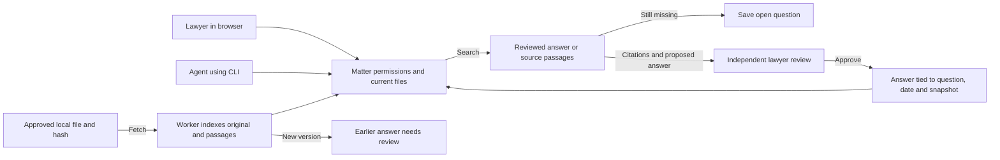

# Use the matter desk

**To practise**, open the launcher in the extracted folder, then follow **Your first matter** in the browser. The demo uses a fictional file and separate researcher and reviewer codes. [First-time setup and walkthrough](practice-setup.md)

**At a firm**, open the desk link supplied by IT, sign in with your own access code, and choose the client matter. Your normal workflow takes place in the browser.

1. **Ask a question.** Enter “What notice period applies to Subsidiary A for convenience termination?” and choose the relevant date. A reviewed answer shows the exact source passages. If the desk shows **Passages to check**, read them and open the originals. Search by exact filename or reference when you already know it.
2. **Bring in missing evidence.** In the demo, open **Bring a file into this matter**, select **Side letter.txt**, and click **Fetch file**. A required file that has yet to arrive appears by name in your search results. When the records owner approves a new version under an existing filename, confirm the replacement in the fetch panel. Search again. Compare the agreement, amendment and signed exception. The expected reading on this route is 30 days for A and 45 for B. The packet contains no delivery receipt. If a needed file is absent from the approved list, save the question and request it from the records owner.
3. **Save what you learned.** Select the passages supporting the answer, including its qualifications. Write the proposed answer with the relevant party, date and route, then click **Send answer for review**. If you cannot answer, click **Save as an open question**. You can reopen it from the list below.
4. **Review it.** A second authorized reviewer opens the proposal, reads its supporting passages and original files, records a reason, then approves or declines. In the practice demo, close the workspace and paste the reviewer code to try this step. In a firm these are separate people. Searching the same question for the same date now returns the approved answer. A change to the registered files or permissions requires fresh review.

Use **Open the contract review workspace** for a reusable notice rule, a hypothetical number of days, or an actual service receipt. A saved research answer records a lawyer’s reading. The notice workflow separately verifies the evidence needed for service. Text search returns passages from the current file inventory, including historical instruments. The selected date scopes a saved answer. A lawyer checks which passages had legal effect on that date.

### Checking a delivery date

In the contract review workspace, register the original proof under the **receipt** document role. A reviewer chooses **Review proof of service** beside that file, reads the original, selects the supporting passage, and enters the party exercising the right, the route, the effective service date, the proposed termination date and the verified conditions. Save the record only if the evidence establishes those facts. If the file just shows dispatch, leave delivery unresolved.

Under **Proof of service**, select the reviewed record and assessment date, then choose **Check notice using this receipt**. The calculation uses the reviewed rule effective on the date of service. To correct a mistake, choose **Withdraw an incorrect delivery record**, record the reason, then enter the corrected record from the original. Withdrawal takes the old record out of current use and preserves the review history. Check the selected party, route and dates if the matter has several notices.

## For an administrator

One-time setup from the project root requires Python 3.12 and uv.

```sh
uv sync --frozen --group pdf --group office --group evidence
.venv/bin/evidence-agent demo
```

For a persistent pilot, follow the [workspace setup](evidence-workspace.md), set `EVIDENCE_LOCAL_ONLY=true` before starting the server, and give staff the firm's approved origin followed by `/desk`. This switch blocks the product’s hosted Codex model even if a matter previously opted in. Network isolation for the whole host remains an IT control. Give each agent its own editor identity and each reviewer a separate reviewer credential and matter membership. The demo runs on loopback in temporary storage and exposes both identities to one person for practice.

The records owner approves each source for a particular matter. Set `EVIDENCE_LIBRARY_CONFIG` to the path of an IT-controlled JSON file outside any writable upload area. Its shape is shown below. Substitute the real matter ID, absolute local path and the 64-character SHA-256 calculated from the approved bytes. Filename is both the agent-visible handle and the workspace document name. Use distinct names for different originals that arrive with the same filename.

```json
{
  "<matter UUID>": {
    "Side letter.txt": {
      "path": "/approved/alder/export/attachments/004.txt",
      "sha256": "<approved file SHA-256>",
      "role": "other"
    }
  }
}
```

Each listed file is required by default. This also applies to earlier configurations without a `required` field. Add `"required": false` for optional background reading. A change to required names, approved hashes or document roles changes the matter snapshot immediately. Until all required versions are indexed, the desk shows their names and reasons, and the notice workflow withholds conclusions. Unknown files outside the list still require custodian reconciliation. Publish updates to this IT-controlled file by atomic replacement.

The desk rechecks file content on fetch. A changed archive file requires an updated approved hash. For an intentional replacement the CLI also requires the current document ID. Preserve relationships and exact original paths in the records register. An archive addition or revoked upstream permission reaches the workspace through the records owner’s reconciliation, registration and membership updates. Firm DMS synchronization and SSO remain integration work. Restrict the manifest, source folders, catalogue, backups and credentials to their designated operators.

## Hosted Codex Sol

The workspace uses the signed-in Codex CLI with `gpt-6.2-sol` for model-assisted selection, first readings, verification and the optional independent reading. The service launches an ephemeral read-only session in a temporary directory for each call. Source passages enter the hosted model context. Use a dedicated service account with an approved Codex login and restrict its operating-system access. Run `codex login status` as that account to verify the login. The tested CLI version is 0.171.0.

For approved hosted processing, set `EVIDENCE_LOCAL_ONLY=false` on the service and enable hosted processing for the specific matter. With local-only mode enabled, the server continues to support search, quotations and reviewed-rule calculations. A missing CLI, failed login or timeout leaves the model review unresolved. Legacy Ollama variables do not select a model in the normal application.

Run `EVIDENCE_LOCAL_ONLY=false python -m benchmarks.codex_notice` from an installed checkout to exercise the hosted route on fictional files. Set `EVIDENCE_NOTICE_EXCEPTION_READER=true` to include an independent pass. The report includes proposed periods, cited filenames, service status, time and tokens. Both passes use Sol and their errors may be correlated.

## Use Evidence OS inside Codex or Claude Code

From the project directory where staff will start their approved agent, install its local instructions once. Make the installed `evidence-agent` executable available on the agent shell’s PATH and provision its own matter-scoped credential through IT.

```sh
evidence-agent connect codex --workspace .
evidence-agent connect claude --workspace .
```

Start a fresh Codex or Claude Code session in that project. In Codex, try **$evidence-os In the Alder matter, find the signed side letter and quote the paragraph about Subsidiary A.** In Claude Code, start the same request with **/evidence-os**. The agent lists its permitted matters, resolves a name to an ID, searches, and can quote the original. A proposed answer enters the same review queue as a browser submission. The connector installs project instructions; it does not log in to either client or grant matter access. Keep the client’s trust, shell permissions and Evidence OS credential under firm control. Text that the agent reads can enter its configured model context, including with Evidence OS in local-only mode. Use a firm-approved model endpoint for that client.

For a first notice review, give the agent the party, termination route and date. For example, “As of 1 March 2026, how much notice must Alder Services give to terminate for convenience? Show the competing clauses.” Read disputed periods and the original passages in the first-review viewer. [Independent check and CLI command](first-time-contract-review.md#independent-exception-reader)

When upgrading a project with an earlier skill, run the same connection command in an empty temporary project. Compare its new `SKILL.md` with the installed one and merge the change through the firm's normal project review. The installer preserves local edits.

Both clients read the same packaged skill from their respective project skill directories. [Codex skills](https://developers.openai.com/codex/skills/) · [Claude Code skills](https://code.claude.com/docs/en/skills)

## For an agent operator

The CLI uses `EVIDENCE_API_URL` (default local port 8765) and `EVIDENCE_AGENT_TOKEN` provisioned by the operator. Remote servers require HTTPS. Set `EVIDENCE_CA_FILE` if the firm uses a private CA. Keep credentials out of prompts, arguments and source control. Run `evidence-agent --help` for the installed commands. Each command returns JSON. A failed request exits nonzero. An unresolved search is a successful request with an explicit status.

```sh
evidence-agent matters
evidence-agent query "$matter" 'C-7' --mode reference
evidence-agent query "$matter" 'Side letter.txt' --mode filename
evidence-agent gap "$matter" "$question" --as-of 2026-03-01
evidence-agent sources "$matter"
evidence-agent fetch "$matter" 'Side letter.txt'
evidence-agent query "$matter" "$question" --as-of 2026-03-01
evidence-agent quote "$matter" "$passage"
evidence-agent open "$matter" "$document" ./verified-original.txt
evidence-agent learn "$matter" "$question" --as-of 2026-03-01 --snapshot "$snapshot" --answer "$draft" --cite "$passage"
evidence-agent inbox "$matter"
evidence-agent receipts "$matter"
evidence-agent check-service "$matter" "$receipt" --as-of 2026-03-03
```

Use the IDs and snapshot returned by the current query. Repeat `--cite` for each decisive passage. With a separate reviewer identity, use the desk or `evidence-agent review "$matter" "$record" approve --reason "$reason"`. Repeating the exact question and date retrieves the approved answer while its snapshot remains current. A different wording starts a fresh search. The inbox includes historical records with a `current` flag. A reviewer can withdraw an incorrect approved answer. Use the returned `next_after` with `inbox --after` for additional entries.

**How agents should use the results.** Show reviewed answers with their citations. To display a quotation, copy the `text`, `filename` and `locator` returned by `quote` directly into the result. Treat ordinary matches as leads. A matching case name shows that a file mentions it. Establishing its holding requires an approved source and review. When a query is unresolved or incomplete, record the gap and identify the missing evidence. In this pilot learning means saving a sourced, independently reviewed answer. There is no model training on the firm's documents.


